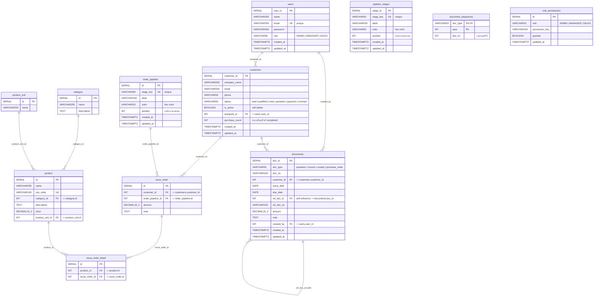

# Entity Relationship Diagram — CRM System

ฐานข้อมูล PostgreSQL สำหรับระบบ CRM

## รายละเอียดตาราง

### `users`

ตารางผู้ใช้งานระบบ มี 3 บทบาท: ADMIN, MANAGER, SALES

### `customers`

ตารางลูกค้า เก็บข้อมูลบริษัท/ลูกค้า สามารถกำหนดผู้รับผิดชอบ (assigned_id) ได้ และมี is_active สำหรับ soft delete

### `pipeline_stages`

ตารางขั้นตอนคำสั่งซื้อ (Order Pipeline) กำหนด stage_key, label, color และลำดับการแสดงผล

### `documents`

ตารางเอกสาร รองรับหลายประเภท: quotation, invoice, receipt, purchase_order
สามารถอ้างอิงเอกสารอื่นได้ (ref_doc_id) เช่น ใบแจ้งหนี้อ้างอิงใบเสนอราคา

### `document_sequences`

ตารางเก็บเลขลำดับเอกสาร แยกตามประเภทและปี ใช้สำหรับสร้างเลขที่เอกสารอัตโนมัติ

### `role_permissions`

ตารางสิทธิ์การเข้าถึง แยกตาม role และ permission_key เช่น dashboard, customers, documents

### `category`

ตารางกลุ่มสินค้า เก็บ id, name (ชื่อกลุ่ม) และ description (รายละเอียด)
(เดิมชื่อ `product_type` → `product_group` → ปัจจุบันคือ `category`)

### `product_unit`

ตารางหน่วยสินค้า เก็บ id และ name (ชื่อหน่วย เช่น ชิ้น, กล่อง, แพ็ก)

### `product`

ตารางสินค้า เก็บ id, name (ชื่อสินค้า), sku_code (รหัสสินค้า), category_id (กลุ่มสินค้า), description (รายละเอียด), price (ราคา) และ product_unit_id (หน่วยสินค้า)

### `order_pipeline`

ตารางขั้นตอนของใบสั่งซื้อ เก็บ id, stage_key, label, color, position และ timestamp
หมายเหตุ: เป็นตารางแยกจาก `pipeline_stages` (ตารางเดิมที่ฝั่ง Kanban ของลูกค้าใช้อยู่)

### `issue_order`

ตารางใบสั่งซื้อ เก็บ id, customer_id (ลูกค้า), order_pipeline_id (ขั้นตอน), amount (ยอดรวม) และ note

### `issue_order_detail`

ตารางรายละเอียดสินค้าในใบสั่งซื้อ เก็บ id, product_id (สินค้า) และ issue_order_id (ใบสั่งซื้อ)
เมื่อลบใบสั่งซื้อ รายละเอียดจะถูกลบตาม (ON DELETE CASCADE)

## ความสัมพันธ์หลัก

| ความสัมพันธ์  | รายละเอียด                                                                     |
| ------------------------- | ---------------------------------------------------------------------------------------- |
| users → customers        | ผู้ใช้ 1 คนรับผิดชอบลูกค้าหลายรายการ (assigned_id)      |
| users → documents        | ผู้ใช้ 1 คนสร้างเอกสารหลายฉบับ (created_by)                   |
| customers → documents    | ลูกค้า 1 รายมีเอกสารหลายฉบับ                                    |
| documents → documents    | เอกสารอ้างอิงเอกสารอื่น (ref_doc_id)                              |
| customers → issue_order  | ลูกค้า 1 รายมีใบสั่งซื้อหลายใบ (customer_id)                      |
| order_pipeline → issue_order | ขั้นตอน 1 ขั้นมีใบสั่งซื้อหลายใบ (order_pipeline_id)          |
| issue_order → issue_order_detail | ใบสั่งซื้อ 1 ใบมีรายละเอียดสินค้าหลายรายการ (issue_order_id) |
| product → issue_order_detail | สินค้า 1 รายปรากฏในรายละเอียดหลายรายการ (product_id) |
| category → product       | กลุ่ม 1 กลุ่มมีสินค้าหลายรายการ (category_id)                   |
| product_unit → product  | หน่วย 1 หน่วยมีสินค้าหลายรายการ (product_unit_id)      |
