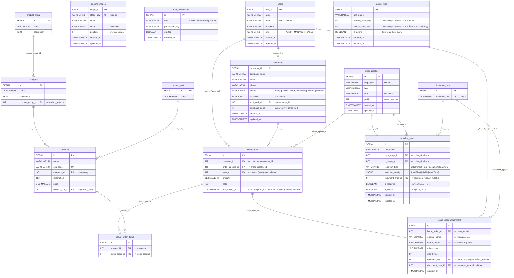

# Entity Relationship Diagram — CRM System

ฐานข้อมูล PostgreSQL สำหรับระบบ CRM

## รายละเอียดตาราง

### `users`

ตารางผู้ใช้งานระบบ มี 3 บทบาท: ADMIN, MANAGER, SALES

### `customers`

ตารางลูกค้า เก็บข้อมูลบริษัท/ลูกค้า สามารถกำหนดผู้รับผิดชอบ (assigned_id) ได้ และมี is_active สำหรับ soft delete

### `pipeline_stages`

ตารางขั้นตอนคำสั่งซื้อ (Order Pipeline) กำหนด stage_key, label, color และลำดับการแสดงผล

### `document_type`

ตาราง lookup ประเภทเอกสาร เก็บ id และ document_type (ชื่อประเภท เช่น quotation, invoice, receipt, purchase_order) — ใช้เป็น master list ของประเภทเอกสารในระบบ

- (เดิม) ตาราง `documents` และ `document_sequences` ถูกยกเลิกแล้วโดย migration `024_drop_documents_and_create_document_type.sql`

### `role_permissions`

ตารางสิทธิ์การเข้าถึง แยกตาม role และ permission_key เช่น dashboard, customers, documents

### `category`

ตารางหมวดหมู่สินค้า เก็บ id, name (ชื่อหมวด), description (รายละเอียด) และ product_group_id (กลุ่มสินค้า)

- ชื่อเมนู UI คือ **Categories / หมวดหมู่สินค้า** (หน้า `/categories`)
- (เดิมชื่อ `product_type` → `product_group` → ปัจจุบันคือ `category`)
- หมวดหมู่ผูกกลุ่มสินค้าผ่านคอลัมน์ `product_group_id` (FK → `product_group.id`)

### `product_unit`

ตารางหน่วยสินค้า เก็บ id และ name (ชื่อหน่วย เช่น ชิ้น, กล่อง, แพ็ก)

### `product`

ตารางสินค้า เก็บ id, name (ชื่อสินค้า), sku_code (รหัสสินค้า), category_id (หมวดหมู่สินค้า), description (รายละเอียด), price (ราคา) และ product_unit_id (หน่วยสินค้า)
หมายเหตุ: กลุ่มสินค้าไม่ได้ผูกกับสินค้าโดยตรง แต่ผูกผ่าน `category.product_group_id`

### `product_group`

ตารางกลุ่มสินค้า (master list) เก็บแค่ id, name (ชื่อกลุ่ม) และ description (รายละเอียด) — ไม่มี FK ไปตารางอื่น

- ชื่อเมนู UI คือ **Product Group / กลุ่มสินค้า** (หน้า `/product-groups` ในกลุ่ม Product Management)
- หมวดหมู่ผูกกลุ่มผ่านคอลัมน์ `category.product_group_id` (FK → `product_group.id`)
- 1 กลุ่มมีหมวดหมู่ได้หลายรายการ / หมวดหมู่ 1 รายการอยู่ในกลุ่มเดียว
- สินค้าสืบค้นกลุ่มสินค้าผ่าน `product.category_id` → `category.product_group_id`

### `order_pipeline`

ตารางขั้นตอนของใบสั่งซื้อ เก็บ id, stage_key, label, color, position และ timestamp
หมายเหตุ: เป็นตารางแยกจาก `pipeline_stages` (ตารางเดิมที่ฝั่ง Kanban ของลูกค้าใช้อยู่)

### `issue_order`

ตารางใบสั่งซื้อ เก็บ id, customer_id (ลูกค้า), order_pipeline_id (ขั้นตอน), user_id (ผู้รับผิดชอบ/assignee), amount (ยอดรวม), note และ `last_activity_at` (เวลาของกิจกรรมล่าสุด)
- `user_id` nullable: ข้อมูลเดิมเป็น NULL / ลบ user แล้วค่ากลายเป็น NULL (ON DELETE SET NULL)
- `last_activity_at` = จุดเริ่มต้นนับอายุการ์ดของ Aging Rules — ถูกอัปเดตเป็นเวลาปัจจุบัน (reset timer) ทุกครั้งที่มีกิจกรรม: ย้ายขั้นตอน / แก้ไขข้อมูล / อัปโหลดไฟล์ (ค่า NULL ให้ fallback ไป `updated_at`)

### `issue_order_detail`

ตารางรายละเอียดสินค้าในใบสั่งซื้อ เก็บ id, product_id (สินค้า) และ issue_order_id (ใบสั่งซื้อ)
เมื่อลบใบสั่งซื้อ รายละเอียดจะถูกลบตาม (ON DELETE CASCADE)

### `workflow_rules`

ตารางกฎควบคุมการย้ายการ์ดบนบอร์ด Order Pipeline แต่ละ rule กำหนดคู่ From Stage → To Stage, เงื่อนไข (`condition_type` + `condition_config`), บังคับ/ไม่บังคับ (`is_required`) และ เปิด/ปิด (`is_active`)
- `attachment` = ต้องแนบไฟล์อย่างน้อย `minFiles` ไฟล์ / `field` = ต้องกรอกฟิลด์ที่กำหนด / `document` = ต้องมีไฟล์แนบของใบสั่งซื้อที่ `document_type_id` ตรงกับที่ rule ระบุ / `payment` = ต้องมีใบเสร็จของลูกค้ารายนั้น
- `document_type_id` nullable: ใช้เฉพาะ rule ประเภท `document` (rule อื่นเป็น NULL), ลบ `document_type` แล้วกลายเป็น NULL (ON DELETE SET NULL)
- `condition_config.docType` (string) เก็บไว้เป็น fallback เท่านั้น — แหล่งความจริงคือคอลัมน์ `document_type_id`
- เมื่อลบขั้นตอนใน `order_pipeline` rule ของขั้นตอนนั้นจะถูกลบตาม (ON DELETE CASCADE)

### `aging_rules`

ตาราง Time-based Workflow Rules (Aging Rules) — เก็บ Threshold ที่ Admin กำหนดเอง เพื่อเปลี่ยนสีการ์ด Kanban เมื่อไม่มี activity ตามจำนวนวันที่กำหนด แยกจาก `workflow_rules` เพราะไม่มีคู่ From/To Stage
- `warning_after_days` = จำนวนวันที่เริ่มแสดงสีเหลือง (Warning) / `critical_after_days` = จำนวนวันที่เปลี่ยนเป็นสีแดง (Overdue/Critical)
- CHECK constraint: `critical_after_days > warning_after_days >= 1`
- `is_active` = เปิด/ปิด rule รายละใบได้โดยไม่ต้องลบ
- ไม่มี FK ไปตารางอื่น: บอร์ดฝั่ง frontend ดึง Threshold ผ่าน `GET /api/aging-rules` แล้วคำนวณสถานะจาก `issue_order.last_activity_at` เอง (คำนวณใหม่ทุก ~1 นาที ไม่ต้องกด Refresh)

### `issue_order_attachment`

ตาราง metadata ของไฟล์แนบใบสั่งซื้อ (ไฟล์จริงเก็บบนดิสก์ที่ `uploads/attachments`) ใช้ตรวจเงื่อนไข "ต้องแนบไฟล์" ของ Workflow Rule
- `uploaded_by` = ใครเป็นคนอัปโหลดไฟล์ (nullable, ON DELETE SET NULL)
- `document_type_id` = ประเภทเอกสารของไฟล์แนบ (FK → `document_type.id`, nullable, ON DELETE SET NULL)
เมื่อลบใบสั่งซื้อ ไฟล์แนบจะถูกลบตาม (ON DELETE CASCADE)

## ความสัมพันธ์หลัก

| ความสัมพันธ์          | รายละเอียด                                                                                 |
| --------------------------------- | ---------------------------------------------------------------------------------------------------- |
| users → customers                | ผู้ใช้ 1 คนรับผิดชอบลูกค้าหลายรายการ (assigned_id)                  |
| users → issue_order              | ผู้ใช้ 1 คนเป็นผู้รับผิดชอบใบสั่งซื้อหลายใบ (user_id / assignee) |
| customers → issue_order          | ลูกค้า 1 รายมีใบสั่งซื้อหลายใบ (customer_id)                              |
| order_pipeline → issue_order     | ขั้นตอน 1 ขั้นมีใบสั่งซื้อหลายใบ (order_pipeline_id)                    |
| issue_order → issue_order_detail | ใบสั่งซื้อ 1 ใบมีรายละเอียดสินค้าหลายรายการ (issue_order_id) |
| order_pipeline → workflow_rules | ขั้นตอน 1 ขั้นเป็นต้นทาง/ปลายทางของ Rule ได้หลายฉบับ (from_stage_id / to_stage_id) |
| document_type → workflow_rules | ประเภทเอกสาร 1 ประเภทถูกอ้างโดย Rule ได้หลายฉบับ (document_type_id) |
| issue_order → issue_order_attachment | ใบสั่งซื้อ 1 ใบมีไฟล์แนบได้หลายไฟล์ (issue_order_id) |
| users → issue_order_attachment | ผู้ใช้ 1 คนอัปโหลดไฟล์แนบได้หลายไฟล์ (uploaded_by = คนแนบไฟล์) |
| document_type → issue_order_attachment | ประเภทเอกสาร 1 ประเภทใช้กับไฟล์แนบได้หลายไฟล์ (document_type_id) |
| product → issue_order_detail     | สินค้า 1 รายปรากฏในรายละเอียดหลายรายการ (product_id)             |
| category → product               | หมวดหมู่ 1 อันมีสินค้าหลายรายการ (category_id)                          |
| product_group → category         | กลุ่ม 1 กลุ่มมีหมวดหมู่หลายรายการ (product_group_id)                   |
| product_unit → product           | หน่วย 1 หน่วยมีสินค้าหลายรายการ (product_unit_id)                        |
